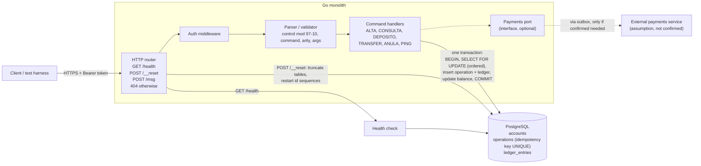

# Design Document: Replacement for the "Caja Negra" service

Facts are marked **[V]** (verified, evidence in `experimentos.jsonl`) or **[?]** (assumption, still to verify).

## 1. Context

We inherited a running HTTP service with no documentation, no source code and nobody to ask. It looks like a financial system: accounts (`ALTA`, `CONSULTA`), money movement (`DEPOSITO`, `TRANSFER`) and reversal (`ANULA`). The company depends on it, so the cost of a mistake is lost or duplicated money, or silent divergence from the original behavior.

Known behavior:
- Endpoints: `GET /health`, `POST /__reset`, `POST /msg`, all behind `Authorization: Bearer <token>` **[V]**.
- Request: `{"m":"CMD;arg;...;CONTROL"}`; command names are case-insensitive **[V]**.
- Control = ISO 7064 mod 97-10: uppercase, drop `;` and `-`, `A=1..Z=26`, keep digits, concatenate into `N`, `control = 98 - ((N*100) mod 97)`. Fits all 68 distinct accepted messages **[V]**.
- Errors seen: E201 control malformed (400), E202 control invalid (400), E301 unknown command (400, body has a trailing space), E302 wrong arity (400), E401 account not found (404), E506 limit exceeded (422), E507 insufficient balance (422) **[V]**.
- IDs are sequential and restart on `/__reset`: `AC-0001...`, `OP-0001...` **[V]**.
- `DEPOSITO` and `TRANSFER` answer `{"status":"recieved","operacionId":"OP-000N"}` (typo is part of the contract); `ANULA` is idempotent (`"ya anulada"`) **[V]**.
- Limits of the black box: 10 req/s, 8000 req/day; behavior may change during the day.

## 2. Problem

1. **Unknown behavior.** We only have black-box access. Unverified: exact limit threshold, effect of `ANULA` on balances, validation order, argument constraints, unknown routes, `/health` body.
2. **Money correctness.** Retries, concurrent requests and crashes must never create double spending, lost updates, negative balances or half-applied transfers.
3. **Exact compatibility.** Hidden tests compare status and body exactly, typos included.

Approach: test the original systematically (log every request with a hypothesis, sweeps, boundary values), turn every verified behavior into a replayable test, and build on standard transaction patterns so the system is safe even where the original's behavior is unknown.

## 3. Solution (single phase)

A Go monolith with PostgreSQL as the only source of truth. Processing is synchronous: the response already contains the final result, as the original returns E401/E506/E507 on the request itself.

A queue or stream (Kinesis, SQS FIFO) was considered and left out: it does not dedup by itself (still needs a Postgres unique key), it complicates two-account transfers, and it turns synchronous errors into request/reply. It can be added later without changing the data model.

### 3.1 Components
- **HTTP router:** `/health`, `/__reset`, `/msg`, default 404; auth middleware.
- **Parser/validator:** split message, check control, command, arity, argument format (before opening a transaction).
- **Command handlers:** one DB transaction each.
- **PostgreSQL:** `accounts`, `operations`, `ledger_entries`.
- **Payments port:** an interface for an external payments service. No such service is confirmed **[?]**; the core works without it.

### 3.2 Data model
- `accounts(id, name, balance BIGINT CHECK (balance >= 0), created_at)`; money in integer units, never floats.
- `operations(id, type, from_account, to_account, amount, status, idempotency_key UNIQUE, created_at, updated_at)`; status `received -> completed | failed | cancelled`.
- `ledger_entries(id, operation_id, account_id, delta, created_at)`; append-only double entry (debit + credit sum to zero), so balances can always be audited.
- Sequences for `AC-` and `OP-` ids, restarted by `/__reset`.

### 3.3 Concurrency and no-double-spend rules
1. **Idempotency key** with a unique constraint; a retry returns the stored result. The original has no key field, so we only dedup if tests show retries are expected to **[?]**.
2. **State machine:** transitions use `UPDATE ... WHERE status = <expected>` and check the row count.
3. **Row locks in fixed order:** `SELECT ... FOR UPDATE` on the accounts by ascending id (prevents A->B / B->A deadlocks).
4. **DB constraint** `balance >= 0` backs up the application check.
5. **Isolation:** `READ COMMITTED` plus explicit locks; `SERIALIZABLE` with retry only if needed.
6. **Outbox** (only if an external payments service is added): the external call never runs inside the DB transaction; a worker sends outbox rows using the stored key.

### 3.4 `TRANSFER` flow
1. Validate message (control, command, arity, amount).
2. `BEGIN`; insert the operation; lock both accounts in id order.
3. Check account existence (E401), balance (E507), limit (E506), in the original's order **[?]**.
4. Write ledger entries, update balances, mark `completed`, `COMMIT`.
5. Reply `{"status":"recieved","operacionId":"OP-000N"}`.

### 3.5 Testing
- Replay `pruebas/ejemplos.jsonl` and every logged experiment against the replacement.
- Differential tests: same random sequences against the original and the replacement after reset, throttled to about 8 req/s.
- Concurrency tests on the replacement: parallel transfers on shared accounts; assert total balance conserved, no negatives, no duplicate effects.
- Crash tests: kill the process mid-request, check consistency on restart.
- Periodic canary against the original to detect drift.

## 4. Edge cases

Each item is a test to write; the expected behavior is **[?]** unless stated.

**Message and control**
- Control `0`, `1`, `99`, `100`, negative, `5X`, empty, 3+ digits; leading zeros (`07`). Known: 1-2 digits required else E201 **[V]**.
- Valid values 2..98; 97 and 98 occur **[V]**.
- Order of checks when several fail (bad control + unknown command + wrong arity). Known: wrong arity returned E302 without checking control in one example **[V]**.
- Empty message, missing `m`, `m` not a string, bad JSON, extra fields, huge body.
- Lowercase/mixed-case command and arguments **[V]** case-insensitive for the control; stored name casing **[?]**.
- Extra or missing `;`, trailing `;`, empty arguments, `;` inside names, non-ASCII or very long names (the control formula ignores non-alphanumerics, so some corruptions go undetected).

**Money**
- Amount `0`, negative, decimals, non-numeric, leading zeros, very large (overflow), exactly at the limit; limit lies between 100000 (ok) and 120000 (E506) **[V]**.
- Transfer to the same account; to or from a missing account (which one is reported first); deposit to a missing account.
- Transfer with insufficient balance at exactly `balance + 1`.
- Two simultaneous transfers that together exceed the balance (only one may succeed).
- Opposite transfers at the same time (deadlock avoidance).

**Operations**
- `ANULA` on unknown id, on already cancelled **[V]**, on a deposit vs a transfer, on a failed operation; effect on balances (observed not restoring in one case **[V]**, unclear).
- Same request sent twice (new operation vs deduped).
- Operation or account ids beyond `9999` (padding), id format case (`ac-0001`).

**HTTP and platform**
- Missing, wrong or malformed token; `GET /msg`; `POST /health`; unknown routes; trailing slashes; missing `Content-Type`.
- `/__reset` during in-flight requests; reset also restarts both id sequences **[V]**.
- Process crash between the operation insert and the commit (must leave nothing partial).
- Rate limiting: whether the original returns 429 and what body **[?]**.
- Drift: the original may change during the day; re-run the canary.

## 5. Risks
- Unobserved behavior differs. Mitigation: differential tests, list unverified items explicitly in the spec.
- Over-claiming in the spec costs points. Mitigation: mark every item with evidence ids and confidence.
- Request budget on the original (8000/day, about 2900 used). Mitigation: prioritize experiments by test impact.

## 6. Architecture

