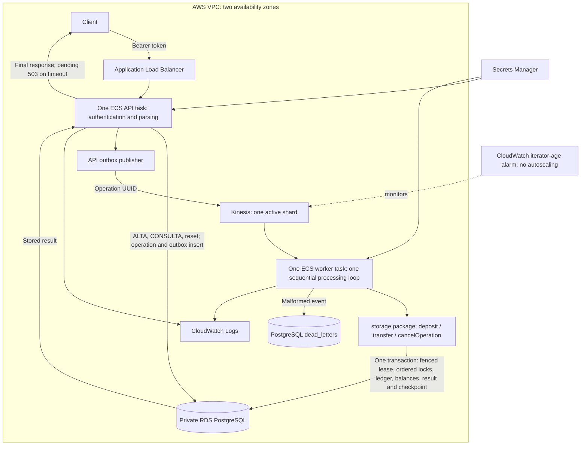

# Design Document: Replacement for the "Caja Negra" service

Facts are marked **[V]** (verified, evidence in `experimentos.jsonl`) or **[?]** (assumption, still to verify).

## 1. Context

We inherited a running HTTP service with no documentation, no source code and nobody to ask. It looks like a financial system: accounts (`ALTA`, `CONSULTA`), money movement (`DEPOSITO`, `TRANSFER`) and reversal (`ANULA`). The company depends on it, so the cost of a mistake is lost or duplicated money, or silent divergence from the original behavior.

Known behavior:
- Endpoints: `GET /health`, `POST /__reset`, `POST /msg`, all behind `Authorization: Bearer <token>` **[V]**.
- Request: `{"m":"CMD;arg;...;CONTROL"}`; command names are case-insensitive **[V]**.
- Control = ISO 7064 mod 97-10: uppercase, drop `;` and `-`, `A=1..Z=26`, keep digits, concatenate into `N`, `control = 98 - ((N*100) mod 97)`. Fits all 68 distinct accepted messages **[V]**.
- Errors seen: E201 control malformed (400), E202 control invalid (400), E301 unknown command (400, body has a trailing space), E302 wrong arity (400), E401 account not found (404), E506 limit exceeded (422), E507 insufficient balance (422) **[V]**.
- IDs are sequential and restart on `/__reset`: `AC-0001...`, `OP-0001...` **[V]**.
- `DEPOSITO` and `TRANSFER` answer `{"status":"recieved","operacionId":"OP-000N"}` (typo is part of the contract); `ANULA` is idempotent (`"ya anulada"`) **[V]**.
- Limits of the black box: 10 req/s, 8000 req/day; behavior may change during the day.

## 2. Problem

1. **Unknown behavior.** We only have black-box access. Remaining risks include untested argument limits, large-number behavior and suggestion rules.
2. **Money correctness.** Retries, concurrent requests and crashes must never create double spending, lost updates or half-applied transfers. Compatibility deliberately preserves negative balances caused by cancellation, as observed and requested.
3. **Exact compatibility.** Hidden tests compare status and body exactly, typos included.

Approach: test the original systematically (log every request with a hypothesis, sweeps, boundary values), turn every verified behavior into a replayable test, and build on standard transaction patterns so the system is safe even where the original's behavior is unknown.

## 3. Solution (single phase)

One Go binary, deployed as two ECS Fargate services: exactly **one API task, one worker task, and one active Kinesis shard**. RDS PostgreSQL is the source of truth. ALTA, CONSULTA and PING execute in the API; DEPOSITO, TRANSFER and ANULA execute in the worker. The API waits for the stored result, preserving synchronous business errors.

The worker has a single processing loop: record 1 commits before record 2 begins. All payment records arrive in the same shard. Autoscaling is disabled. Deployments stop the old task before starting its replacement (maximum 100%, minimum healthy 0%), accepting a brief interruption rather than two consumers.

### 3.1 Components
- **HTTP router:** authenticated `/health`, `/__reset`, `/msg`, default 404; separate unauthenticated `/ready` for ALB health checks.
- **Parser/validator:** split message, check control, command, arity, argument format (before opening a transaction).
- **Outbox publisher:** reliably sends accepted operation IDs to Kinesis, partitioned by tenant and source account; serializes publication per partition across API tasks.
- **Worker:** one synchronous batch-processing loop, without per-record or per-shard processing goroutines. Expiring PostgreSQL leases and fencing protect restart; checkpoints and effects commit together. Historical parent shards drain before the merged single shard during migration.
- **Storage package:** `service/storage`, with explicit `CreateAccount`, `GetAccount`, `QueueDeposit`, `QueueTransfer`, `QueueCancellation`, `OperationResult`, and `Reset` methods. Financial handlers are separated into deposit, transfer and cancellation functions. SQL and transaction management remain inside the package.
- **PostgreSQL:** `tenants`, `accounts`, `operations`, `outbox`, `ledger_entries`, `shard_leases`, `dead_letters`.
- **External payments:** unconfirmed; no provider is called by this implementation.

### 3.2 Data model
- `accounts`: tenant, reset generation, public ID, name, signed BIGINT balance; integer units, never floats. Cancellation overdrafts are allowed for compatibility.
- `operations`: immutable UUID request ID, optional client key, fingerprint, command, arguments, amount, public ID, stored HTTP response and status. Unique key per tenant/generation; state `received -> completed | failed`, with successful money operations optionally `completed -> cancelled`.
- `ledger_entries`: two opposing entries per effect, including a cash-clearing entry for deposits. A deferred database trigger rejects unbalanced journals.
- `tenants`: transactional AC/OP counters and reset generation. Failed operations do not consume public OP identifiers. Reset clears business data and increments generation; old Kinesis records cannot affect new accounts.

### 3.3 Concurrency and no-double-spend rules
1. **Idempotency:** Kinesis duplicates reuse the immutable request ID. An optional `Idempotency-Key` header deduplicates client retries; without it, repeated identical requests are distinct, matching the original. Reusing a key with different input returns 409.
2. **State machine:** the worker locks and rechecks operation state before applying effects; terminal operations return their stored result without another balance change.
3. **Locks:** `READ COMMITTED`, tenant row locks for counters/reset, and account row locks in ascending ID order. Transfers check available funds while holding those locks.
4. **Fenced checkpoints:** shard ownership is checked under a row lock; an expired or superseded worker cannot apply effects. Checkpoint, ledger, balances and response commit atomically.
5. **Outbox:** operation and pending event commit together. Publication can repeat after a crash; consumption remains idempotent. Only outbox/publication locks span the Kinesis call, not balance-changing transactions.
6. **Sequential consumer:** one active shard and one worker loop prevent overlapping payment handlers. This does not serialize HTTP account creation or reset with the worker; database locks still coordinate those requests.

### 3.4 `TRANSFER` flow
1. Validate message (control, command, arity, amount).
2. API commits operation and outbox; publisher sends its UUID to Kinesis.
3. Worker locks shard lease, tenant, operation and both accounts. Check existence (E401), limit (E506), then balance (E507), in the observed order **[V]**.
4. Write balanced ledger entries, update balances, allocate OP ID, save response and checkpoint; commit.
5. API reads the stored result and replies `{"status":"recieved","operacionId":"OP-000N"}`. If the 4.5-second wait expires, return a pending 503 with the request ID; the operation can still complete. Retry safely using the same client key.

### 3.5 Testing
- Replay `pruebas/ejemplos.jsonl` and every logged experiment against the replacement.
- Differential tests: same random sequences against the original and the replacement after reset, throttled to about 8 req/s.
- Verified locally: concurrent spending, duplicate delivery, client idempotency, reversal overdrafts, stale events after reset, expired/superseded leases and unbalanced-journal rollback.
- Previous AWS deployment: 20/20 fixture responses matched the current original; concurrency/idempotency tests passed with two API and two worker tasks, as did real Kinesis redelivery and reset fencing.
- Refactor tests: explicit storage methods retain those transaction guarantees; an ordered deposit, transfer and cancellation batch verifies sequential effects and checkpoint recovery.
- Further crash tests: kill tasks mid-request and during publication; verify recovery.
- Periodic canary against the original to detect drift.

## 4. Edge cases

Each item is a test to write; the expected behavior is **[?]** unless stated.

**Message and control**
- Control `0`, `1`, `99`, `100`, negative, `5X`, empty, 3+ digits; leading zeros (`07`). Known: 1-2 digits required else E201 **[V]**.
- Valid values 2..98; 97 and 98 occur **[V]**.
- Order of checks: missing control, empty segment, malformed/incorrect checksum, unknown command, arity, amount, same-account transfer **[V]**. PING skips checksum validation.
- Empty message, missing `m`, `m` not a string, bad JSON, extra fields, huge body.
- Lowercase/mixed-case command and arguments **[V]** case-insensitive for the control; stored name casing **[?]**.
- Extra or missing `;`, trailing `;`, empty arguments, `;` inside names, non-ASCII or very long names (the control formula ignores non-alphanumerics, so some corruptions go undetected).

**Money**
- Amount `0`, negative, decimals and non-numeric return E303 **[V]**. Transfer limit is 100000 inclusive; 100001 returns E506 **[V]**. BIGINT overflow is rejected by the replacement; larger-number behavior of the original remains unverified.
- Transfer to the same account; to or from a missing account (which one is reported first); deposit to a missing account.
- Transfer with insufficient balance at exactly `balance + 1`.
- Two simultaneous transfers that together exceed the balance (only one may succeed).
- Opposite transfers at the same time (deadlock avoidance).

**Operations**
- `ANULA` reverses deposits and transfers, even if this overdraws an account **[V]**. Unknown OP returns E402; repeated cancellation returns `ya anulada` **[V]**.
- Same request sent twice: distinct effects without a client key; same stored response with the same key. Test a retry after HTTP timeout.
- Operation or account ids beyond `9999` (padding), id format case (`ac-0001`).

**HTTP and platform**
- Missing, wrong or malformed token; `GET /msg`; `POST /health`; unknown routes; trailing slashes; missing `Content-Type`.
- `/__reset` during in-flight requests; reset also restarts both id sequences **[V]**.
- Process crash between the operation insert and the commit (must leave nothing partial).
- Rate limiting: whether the original returns 429 and what body **[?]**.
- Drift: the original may change during the day; re-run the canary.

## 5. Risks
- Unobserved behavior differs. Mitigation: differential tests, list unverified items explicitly in the spec.
- Over-claiming in the spec costs points. Mitigation: mark every item with evidence ids and confidence.
- Cancellation overdrafts are a compatibility risk deliberately preserved; ordinary transfers still reject insufficient funds.
- The single worker bounds throughput: lag grows when transactions arrive faster than they can be processed. Monitor iterator age; one shard provides ordering within this stream, not timestamp ordering or exactly-once delivery.
- Restart and stop-before-start deployment cause brief unavailability. Accepted operations remain recoverable through the outbox and checkpoint; clients retry with the same idempotency key.
- Request budget on the original (8000/day). Mitigation: prioritize experiments by test impact.

## 6. Architecture

